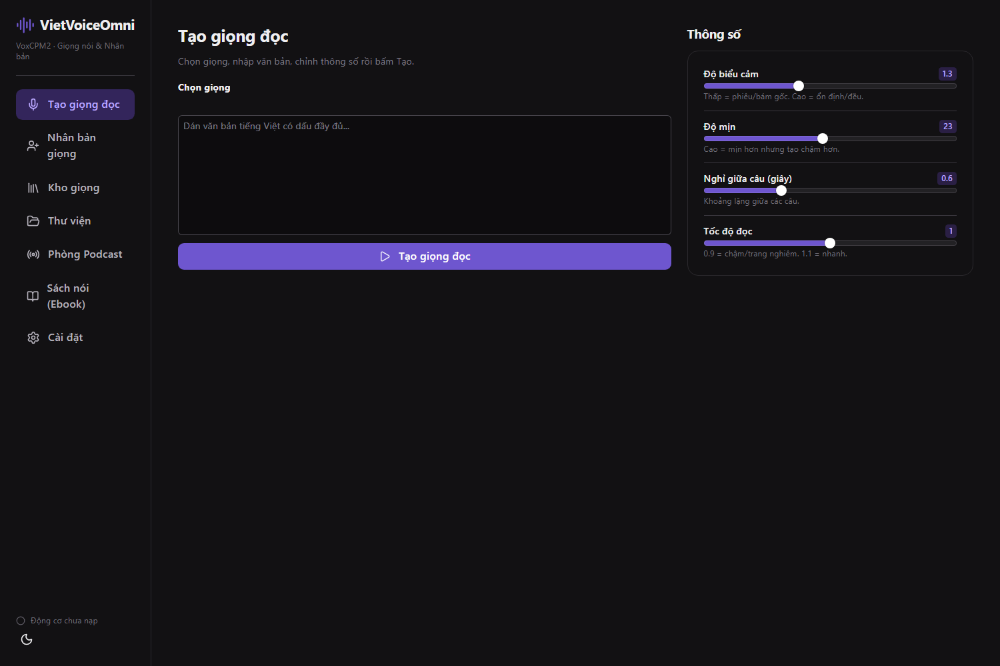
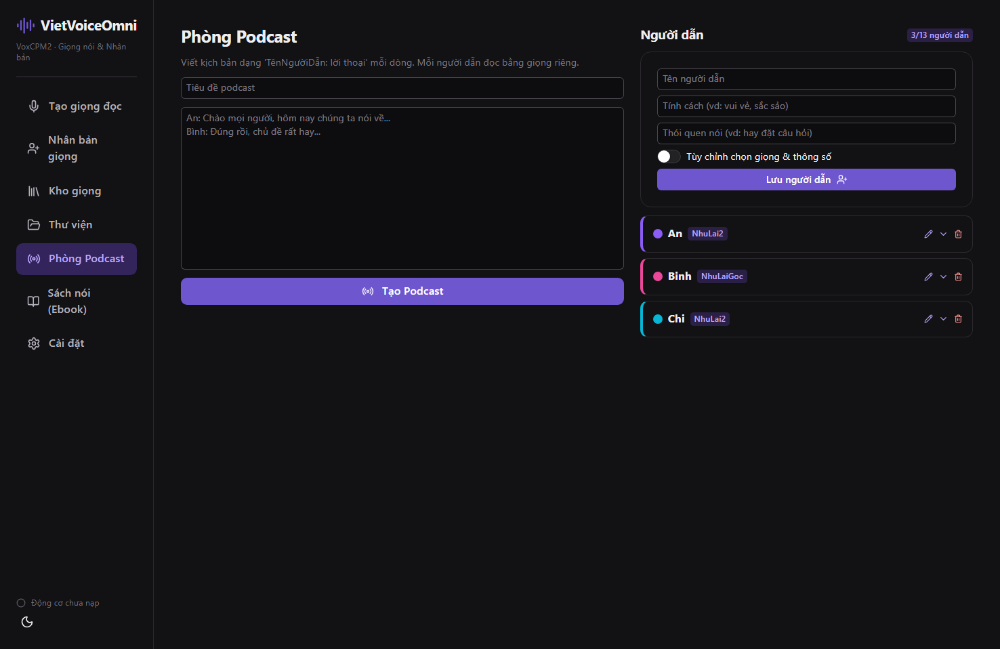
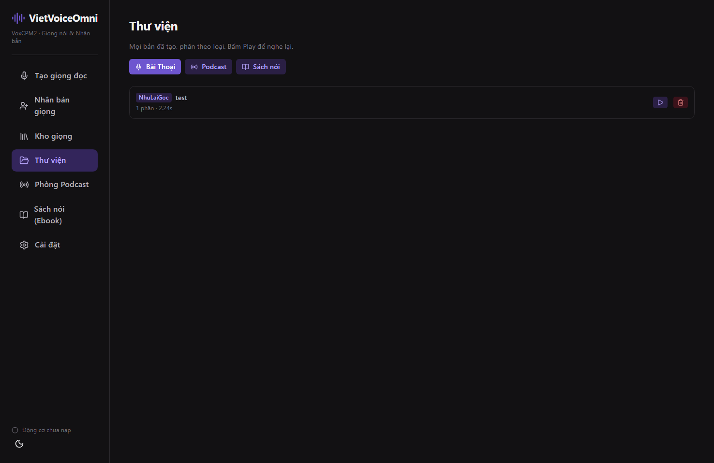
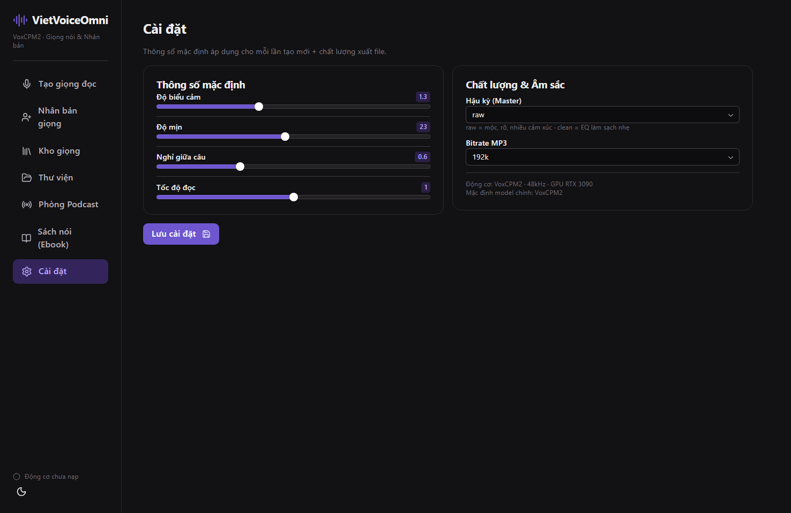

<div align="center">

# 🎙️ VietVoiceOmni

**Bộ công cụ Text-to-Speech & nhân bản giọng nói tiếng Việt — một giao diện, đầy đủ tính năng.**

Xây trên engine **[VoxCPM2](https://huggingface.co/openbmb/VoxCPM2)**, giao diện **[Reflex](https://reflex.dev)** (Python → React), giao diện hoàn toàn tiếng Việt.

[](LICENSE)
[](https://www.python.org)
[](https://reflex.dev)
[](https://huggingface.co/openbmb/VoxCPM2)

</div>

---

## ✨ Tính năng

| Tính năng | Mô tả |
|---|---|
| 🎤 **Tạo giọng đọc** | Nhập văn bản tiếng Việt → đọc bằng giọng đã clone. Thanh tiến trình + **ETA (còn bao lâu xong)** theo từng câu. |
| 👤 **Nhân bản giọng** | Tải 1 đoạn audio mẫu (3–30s) → tạo giọng mới chỉ trong vài giây. |
| 📚 **Kho giọng** | Quản lý mọi giọng đã lưu, kèm thông số riêng. |
| 🗂️ **Thư viện** | Lịch sử chia 3 mục: **Bài Thoại / Podcast / Sách nói**. Nghe lại, tải, xoá. |
| 📻 **Phòng Podcast** | Tạo tối đa **13 người dẫn**, mỗi người có **tên, tính cách, thói quen, màu riêng** và **thông số giọng riêng**. Sinh hội thoại nhiều người từ kịch bản. |
| 📖 **Sách nói (Ebook)** | Tải **EPUB/TXT** → tự tách chương → xuất audiobook ghép đầy đủ. |
| ⚙️ **Cài đặt** | Thông số mặc định, chế độ hậu kỳ (RAW/Clean), bitrate MP3. Lưu thật vào DB. |

### 🎛️ Thông số bằng tiếng Việt dễ hiểu

| Nhãn tiếng Việt | Tham số gốc | Ý nghĩa |
|---|---|---|
| **Độ biểu cảm** | `cfg_value` | Thấp = phiêu/bám mẫu · Cao = ổn định/đều |
| **Độ mịn** | `inference_timesteps` | Cao = mịn hơn nhưng tạo chậm hơn |
| **Nghỉ giữa câu** | `pause` | Khoảng lặng giữa các câu (giây) |
| **Tốc độ đọc** | `atempo` (ffmpeg) | 0.9 = chậm/trang nghiêm · 1.1 = nhanh |

---

## 🖼️ Giao diện

Giao diện tối, gọn, tiếng Việt có dấu đầy đủ.

| Tạo giọng đọc | Phòng Podcast |
|---|---|
|  |  |

| Thư viện | Cài đặt |
|---|---|
|  |  |

---

## 🚀 Cài đặt nhanh

### Yêu cầu
- Python **3.10+**
- **Node.js** (Reflex tự cài bun cho frontend)
- **ffmpeg** (xuất MP3 + điều chỉnh tốc độ đọc)
- GPU NVIDIA khuyến nghị (engine chạy bf16 trên CUDA). Mặc định cấu hình cho RTX 3090 (24GB).
- Trọng số model **VoxCPM2** (`openbmb/VoxCPM2`) — tải từ Hugging Face.

### Các bước

```bash
# 1. Tạo môi trường ảo + cài phụ thuộc
python -m venv .venv
.venv/Scripts/activate        # Windows
# source .venv/bin/activate   # Linux/macOS
pip install -r requirements.txt

# 2. Tải model VoxCPM2 (lần đầu)
#    Engine sẽ tự tải về ~/.cache/huggingface khi chạy lần đầu,
#    hoặc đặt sẵn nếu chạy offline (HF_HUB_OFFLINE=1).

# 3. Chạy app
reflex run --env dev
```

Mặc định mở tại **http://localhost:3000/** (cấu hình cổng trong `rxconfig.py`).

> ℹ️ Repo này cấu hình sẵn cổng **3101 / 8012** để tránh đụng cổng khác. Sửa trong `rxconfig.py` nếu cần.

### Trỏ tới engine VoxCPM2

App cần mã nguồn engine `voxcpm_engine.py` và `VoxCPM/src`. Mặc định tìm ở thư mục cha 2 cấp (đặt repo cạnh `VietVoice/` và `VoxCPM/`). Nếu đặt nơi khác, trỏ bằng biến môi trường:

```bash
export VOXCPM_ROOT=/duong/dan/chua/VietVoice-va-VoxCPM   # Linux/macOS
$env:VOXCPM_ROOT="D:\path\chua\VietVoice-va-VoxCPM"     # Windows
```

---

## 🧱 Kiến trúc

```
VietVoiceOmni/
├── VietVoiceOmni/
│   ├── VietVoiceOmni.py      # UI (Reflex) — 7 tab, theme tối
│   ├── state.py              # State + toàn bộ logic nghiệp vụ
│   └── backend/
│       ├── voice_service.py  # Wrapper VoxCPM2 (model resident, progress/ETA, atempo, xuất MP3)
│       ├── db.py             # SQLite: voices / history / hosts / podcasts / settings
│       └── ebook.py          # Parser EPUB/TXT → tách chương
├── rxconfig.py               # Cấu hình Reflex (cổng, plugin)
├── requirements.txt
├── SPEC.md                   # Đặc tả + checklist audit
├── LICENSE                   # Apache 2.0
└── README.md
```

**Luồng hoạt động:**
1. UI (Reflex) gọi event trong `state.py`.
2. `state.py` gọi `VoiceService` (giữ model VoxCPM2 thường trú trong RAM/VRAM — nạp 1 lần).
3. Engine sinh audio theo từng câu, trả progress + ETA về UI.
4. Hậu kỳ (atempo tốc độ đọc) + xuất MP3 qua ffmpeg.
5. Lưu lịch sử vào SQLite, phân loại theo `kind` (speech/podcast/audiobook).

---

## 🎚️ Engine: VoxCPM2

- Model chính & mặc định: **`openbmb/VoxCPM2`**.
- Sample rate 48kHz, bf16, chạy trên CUDA.
- Tốc độ đọc điều chỉnh hậu kỳ bằng ffmpeg `atempo` (engine không có tham số tốc độ riêng).
- Điều khiển cảm xúc bằng cú pháp `[...]`/`(...)` **không** dùng cho tiếng Việt — hãy viết văn bản có dấu + dấu câu đầy đủ để model tự diễn cảm xúc.

---

## ✅ Đã audit (chạy thật)

- Sinh audio thật ra MP3, model resident, progress + ETA theo từng câu.
- `atempo` điều chỉnh tốc độ đọc thật (audio dài/ngắn theo hệ số).
- Podcast nhiều người: ghép nhiều giọng theo kịch bản thành 1 file.
- Mỗi người dẫn có **màu riêng** + **thông số giọng riêng**; giới hạn **13 người**.
- Thư viện lọc đúng 3 loại; Cài đặt lưu/nạp thật.
- Sách nói: parse EPUB/TXT → tách chương → ghép audiobook.

Chi tiết checklist trong [`SPEC.md`](SPEC.md).

---

## 📜 Giấy phép

[Apache License 2.0](LICENSE) © 2026 OUM Studio (NACHA).

Trọng số model **VoxCPM2** thuộc giấy phép riêng của `openbmb` — vui lòng tuân thủ điều khoản gốc.

---

## 🙏 Ghi nhận

- [VoxCPM2 — openbmb](https://huggingface.co/openbmb/VoxCPM2) — engine TTS.
- [Reflex](https://reflex.dev) — framework UI Python.
